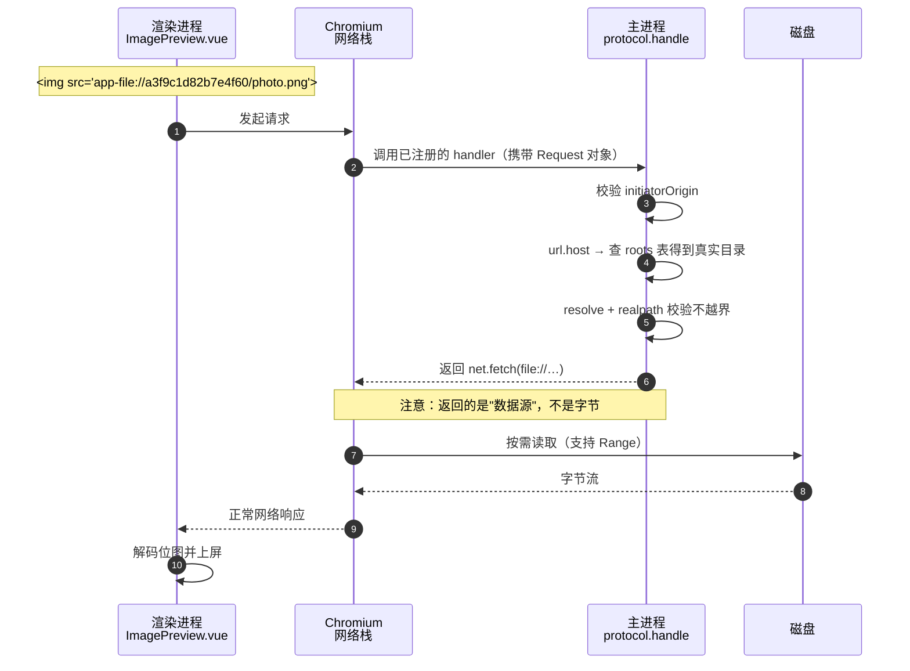

# app-file 协议数据流转

本文说明图片预览如何从磁盘到达界面：为什么用自定义协议替代 IPC 传输二进制，以及一份字节到底经过了哪些层。

配套阅读：[IPC 通信](./ipc.md)、[开发启动时序](./dev-startup.md)

---

## 问题：为什么不用 IPC 传图片

最初的实现是主进程读文件、转 base64、通过 IPC 返回 data URL：

```ts
const buffer = await fs.readFile(filePath)
return { dataUrl: `data:${mime};base64,${buffer.toString('base64')}` }
```

这条路径有三次不必要的拷贝：

| 环节 | 代价 |
| --- | --- |
| `fs.readFile` | 整个文件进主进程内存 |
| `base64` 编码 | 体积膨胀约 33%，且是不可复用的字符串 |
| IPC 结构化克隆 | 再完整拷贝一次到渲染进程 |

一张 10 MB 的图，峰值内存约 13 MB 字符串 + 一份克隆副本。`<video>`、PDF 这类需要 Range 请求（拖进度条、按页加载）的场景，此方案根本做不了 —— 数据必须一次性全量到达。

---

## 方案：自定义协议 + Chromium 网络栈

注册一个 `app-file://` 协议，让 Chromium 把它当成正经的网络请求处理，由 Chromium 自己读盘。

主进程只回答一个问题：**这个路径你准不准读**。字节本身从不经过主进程的 JS。

### 注册时机

分两步，顺序不能颠倒：

```ts
// ① 必须在 app ready 之前，且只能调用一次 —— 放在 index.ts 模块顶层
protocol.registerSchemesAsPrivileged([
    {
        scheme: 'app-file',
        privileges: { standard: true, secure: true, supportFetchAPI: true, stream: true }
    }
])

// ② ready 之后挂上处理器
protocol.handle('app-file', async (request) => { ... })
```

各开关的作用：

| 开关 | 作用 |
| --- | --- |
| `standard` | 让 URL 按 `scheme://host/path` 解析。**没有它就取不出 `url.host`**，也就没地方放 rootId |
| `secure` | 视为安全上下文，与 https 同级 |
| `supportFetchAPI` | 允许 `fetch()` 请求该协议，pdf.js 等库依赖它 |
| `stream` | 允许流式消费与 Range 请求，`<video>` seek、PDF 按页加载依赖它 |

**刻意不开启 `bypassCSP`**：放行 `app-file:` 应当写在 CSP 里显式声明，
而不是给自己留一条绕过 CSP 的通用通道。CSP 定义见根目录 `csp.constant.ts`（生产）与 `index.html`（开发）。

---

## 完整数据流



关键点在第 6 步：handler 返回的是一个 `Response`，里面包着**由 Chromium 管理的流**。真正的读盘发生在 Chromium 的 net 线程，不在我们的 JS handler 里。

因此从头到尾没有任何一方完整持有文件字节 —— 这与 `fs.readFile` 是对立的。

---

## URL 的构造

```
app-file://a3f9c1d82b7e4f60/photo.png?v=1730612345678
           └── rootId ──┘ └ 文件名 ┘  └ 缓存版本 ┘
```

URL **不携带真实路径**。`rootId` 指向上一步生成的 16 位随机 hex 字符串，与磁盘位置没有可逆关系。

真实路径只存在于主进程内存的两张表（`src/main/lib/workspace.ts`）：

```
roots:        rootId → "e:\code\study\photos"   // 小写规范化，用于安全校验
displayPaths: rootId → "E:\code\study\photos"   // 原始大小写，用于实际读盘
```

分成两张表的原因：Windows 上 `realpath` 的结果会转成小写，用它去读盘会丢失原始大小写；而安全比较又需要大小写无关。

`?v=mtimeMs` 是缓存版本号。文件内容被覆盖而路径不变时，带时间戳的新 URL 会让 Chromium 重新拉取，
而不是命中缓存。

---

## handler 的三道校验

`src/main/protocol.ts` 中的 `protocol.handle` 依次检查：

### 1. 发起方是否可信

```ts
const isTrustedInitiator = (initiatorOrigin: string | undefined): boolean => {
    if (!initiatorOrigin) return false
    if (DEV_SERVER_URL) return initiatorOrigin === new URL(DEV_SERVER_URL).origin
    return initiatorOrigin === 'file://' || initiatorOrigin === 'null'
}
```

`request.initiatorOrigin` 由 Electron 填充，**不受请求方控制**（官方文档明确建议优先用它而不是 `request.referrer`）。

没有这道校验，任何页面内的 iframe（例如将来预览一个恶意 HTML）都可以构造 `app-file://` 请求读取任意已授权文件。

> 当前生产分支放行了 `'null'`，这是为 sandboxed iframe 留的口子，属于放宽项。若后续要预览 HTML 文件，应改为按 `webContents` 校验。

### 2. rootId 是否已授权

查 `roots` 表，查不到直接 404。未授权过的 ID 无法触达任何文件。

### 3. 解析后的路径是否仍在根目录内

```ts
const absolute = await canonicalize(path.resolve(root, normalized))
if (absolute !== root && !absolute.startsWith(root + path.sep)) return null
```

`canonicalize` 内部用 `fs.realpath`，因此同时挡住了两种逃逸：

- `..` 相对路径穿越
- 符号链接指向根目录之外

---

## 流入与流出对照

| | 旧：data URL over IPC | 新：app-file 协议 |
| --- | --- | --- |
| 触发方式 | `ipcRenderer.invoke('image:read')` | `` 触发网络请求 |
| 主进程返回 | base64 字符串 | `Response`（数据源描述） |
| 字节是否经过主进程 JS | 是，完整持有 | 否 |
| 内存峰值 | ≈ 文件大小 × 1.33 × 2 | 解码后的位图 |
| Range 请求 | 不支持 | 支持 |
| 大文件 | 受内存限制 | 流式，无上限 |
| 是否含真实路径 | 一度包含（已移除） | 否，仅 rootId |

---

## 授权的生命周期

因为每次请求都重新查 `roots` 表，**撤销即刻生效**：撤掉某个 rootId 后，所有携带该 ID 的 URL 下一次请求就是 404。

授权在以下时机失效：

| 时机 | 实现位置 |
| --- | --- |
| 用户点「清除」 | `ImagePreview.reset()` → `revokeAppFile(url)` |
| 切换到另一张图 | `applyImage()` 先释放上一张 |
| 源文件被删除或改名 | 预留：文件树接入 `fs.watch` 后调用同一接口 |
| 窗口关闭 | `win.on('closed', disposeAppFileProtocol)` → `revokeAllRoots()` |
| 应用退出 | `window-all-closed` 同上 |

`app-file:revoke` 接收**完整 URL** 而非裸 rootId，由主进程解析并校验格式（`/^[0-9a-f]{16}$/`）。这样渲染层不需要复制一份 URL 结构知识。

> 没有设置过期时间。攻击者若已能发起请求，不会等待过期；而过期只会误伤正在看图回来看的用户。限制的维度应当是"窗口 / 用户主动撤销"，而非时钟。

---

## 相关文件

| 文件 | 职责 |
| --- | --- |
| `csp.constant.ts` | 协议名常量与生产 CSP，主进程与 `vite.config.ts` 共用 |
| `src/main/protocol.ts` | 协议注册、handler、发起方校验 |
| `src/main/lib/workspace.ts` | rootId ↔ 目录映射、路径穿越防护、撤销 |
| `src/main/lib/image.ts` | 校验扩展名与大小，生成 URL |
| `src/main/ipc/appFile.ts` | `app-file:revoke` 处理器 |
| `src/main/ipc/image.ts` | `image:pick` / `image:describe` |
| `src/preload/index.ts` | 向页面暴露 `describeImage` / `revokeAppFile` |
| `src/shared/types.ts` | `ImagePreviewResult`、`RevokeRootResult` |
| `src/renderer/components/ImagePreview.vue` | 使用方 |

---

## 验证方法

开发模式下选一张图，打开 DevTools 的 Network 面板：

- 能看到类型为 `Img` 的 `app-file://` 请求，状态 200
- 响应体是图片二进制

撤销后再请求同一 URL 应当返回 404。可在控制台临时保留 URL 后点「清除」验证：

```js
const url = document.querySelector('.preview__image').src
// 点「清除」
await fetch(url)   // 期望 404
```

---

## 已知限制

1. **生产模式（`file://`）的 `initiatorOrigin` 未实测**。代码同时接受 `file://` 与 `null`，若打包后图片全部 403，应先打印该值确认。
2. **单窗口假设**。授权表是全局的，`win.on('closed')` 会清空全部授权。当前代码只创建单窗口（`getAllWindows().length === 0` 时才新建），故不构成问题；多窗口时需改为按窗口隔离。
3. **无主动监听**。文件在磁盘上被替换后，需重新生成 URL 或依赖 `?v=mtimeMs` 变化才会刷新。
