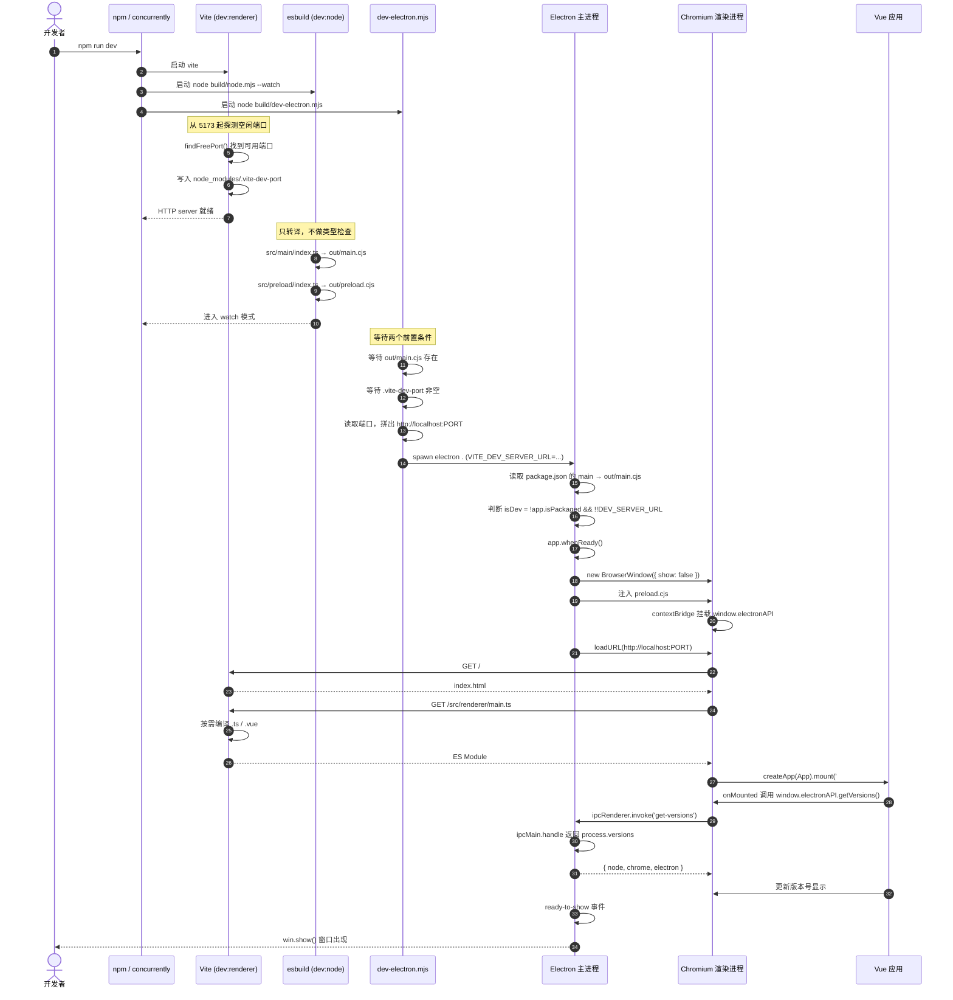
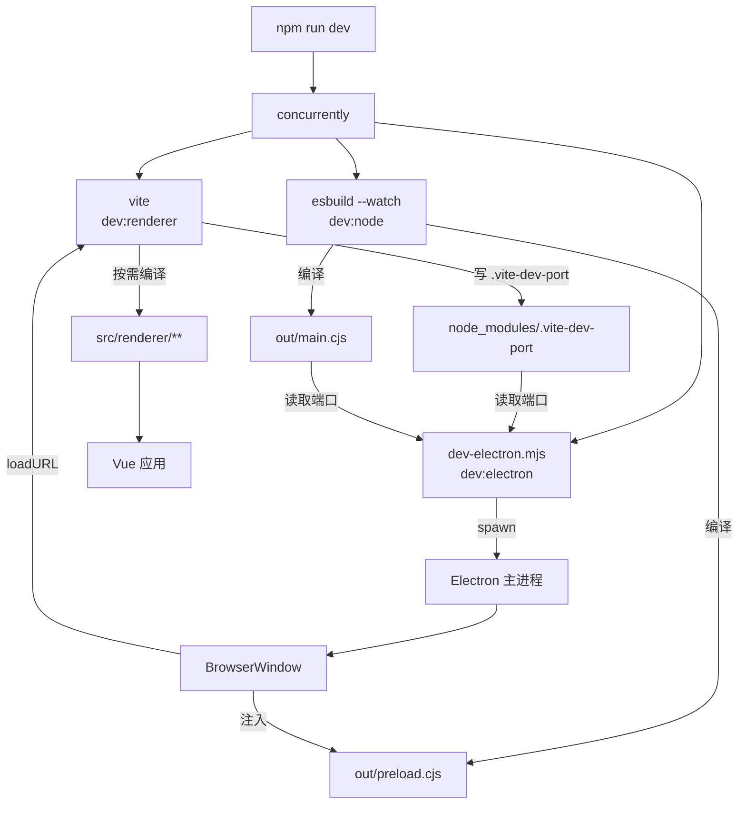

# 开发阶段启动时序

本文描述 `npm run dev` 从按下回车到窗口出现、页面渲染完成的完整过程，以及各种代码改动分别如何生效。

配套阅读：[README](../README.md)、[文件说明](./files.md)

---

## 总览

`npm run dev` 由 `concurrently` 同时拉起三个子任务，它们各自负责一部分产物，最后汇合到同一个 Electron 窗口上。

| 子任务 | 命令 | 职责 | 产物 |
| --- | --- | --- | --- |
| `dev:renderer` | `vite` | 渲染进程（Vue）开发服务器 | 内存中的 ES Module，不落盘 |
| `dev:node` | `node build/node.mjs --watch` | 编译主进程与预加载脚本 | `out/main.cjs`、`out/preload.cjs` |
| `dev:electron` | `node build/dev-electron.mjs` | 等条件就绪后启动 Electron | 窗口进程 |

---

## 完整时序图



---

## 分步说明

### 第 1 步：三路并行启动

`concurrently` 同时拉起三个 npm 脚本，日志分别带 `[vite]`、`[esbuild]`、`[electron]` 前缀与颜色。

`-k`（kill-others）保证任意一路退出时其余全部关闭，避免残留后台进程占住端口。

### 第 2 步：Vite 探测端口并广播

1. 读取 `vite.config.ts`
2. 从 5173 开始逐个尝试 `listen(port, 'localhost')`，第一个成功监听的就是实际端口
3. 把实际端口写入 `node_modules/.vite-dev-port`
4. 启动 HTTP server

**为什么要有端口文件**：Electron 启动脚本需要知道 Vite 最终用了哪个端口。写死 5173 时，一旦端口被占导致 Vite 顺延，Electron 就会连错地址白屏。

### 第 3 步：esbuild 编译主进程

1. `src/main/index.ts` → `out/main.cjs`
2. `src/preload/index.ts` → `out/preload.cjs`
3. 进入 watch 模式

**只转译，不校验类型**。类型错误在这一步不会报，需要 `npm run typecheck`。

### 第 4 步：dev-electron 等待条件

```
等待 out/main.cjs 存在                                  ← 由 esbuild 提供
等待 node_modules/.vite-dev-port 非空                    ← 由 Vite 提供
```

两个条件都满足后，读取端口、设置环境变量、`spawn('npx electron .')`。

### 第 5 步：Electron 启动主进程

`npx electron .` 读取 `package.json` 的 `main` 字段（`out/main.cjs`），在 Node 环境执行。

```ts
const DEV_SERVER_URL = process.env.VITE_DEV_SERVER_URL
const isDev = !app.isPackaged && !!DEV_SERVER_URL
```

| 条件 | 作用 |
| --- | --- |
| `!app.isPackaged` | 打包后即使残留环境变量，也不会误连 dev server |
| `!!DEV_SERVER_URL` | 直接 `electron .`（未设变量）时走生产分支，加载 `dist/index.html` |

### 第 6 步：创建窗口（不显示）

```ts
new BrowserWindow({ show: false, webPreferences: { ... } })
```

`show: false` 用于防止白屏闪烁，等首帧渲染完成再显示。

### 第 7 步：注入预加载脚本

`preload.cjs` 在页面脚本之前执行，通过 `contextBridge` 把 API 挂到 `window`：

```ts
contextBridge.exposeInMainWorld('electronAPI', { ... })
```

顺序必须是：**preload 执行 → 挂载 API → 页面 JS 才能调用**。顺序反了 `window.electronAPI` 就是 `undefined`。

### 第 8 步：加载页面

```ts
win.loadURL(DEV_SERVER_URL)
```

渲染进程请求 `http://localhost:PORT/`，Vite 返回 `index.html`。其中的
`<script type="module" src="/src/renderer/main.ts">` 再触发对 TS / Vue 文件的请求。

**这些文件是在浏览器请求时才编译的**，不是启动时一次性编译完毕 —— 这也是 Vite 启动快的原因。

### 第 9 步：Vue 挂载与 IPC 通信

1. `createApp(App).mount('#app')`
2. `App.vue` 的 `onMounted` 调用 `window.electronAPI.getVersions()`
3. 预加载脚本 → `ipcRenderer.invoke('get-versions')`
4. 主进程 `ipcMain.handle` 返回 `process.versions`
5. Promise resolve，视图更新

### 第 10 步：显示窗口

`ready-to-show` 触发后 `win.show()`，用户看到的是已渲染好的界面。

---

## 进程关系图



---

## 改动如何生效

| 改动位置 | 处理者 | 生效方式 | 是否需要手动操作 |
| --- | --- | --- | --- |
| `src/renderer/**`（`.vue` / `.ts` / `.css`） | Vite HMR | 立即生效，窗口不刷新 | 否 |
| 渲染进程新增 `import` 的文件 | Vite | 同上 | 否 |
| `src/preload/index.ts` | esbuild 重编译 | `out/preload.cjs` 更新，已开窗口不会自动重载 preload | **是**：`Ctrl+R` 刷新窗口 |
| `src/main/index.ts` | esbuild 重编译 | `out/main.cjs` 更新，主进程不重启 | **是**：重启 `npm run dev` |
| `vite.config.ts` | — | 需重启 Vite | **是**：重启 `npm run dev` |
| `package.json` 的 `main` | — | 需重启 Electron | **是**：重启 `npm run dev` |

> 主进程与预加载脚本都不会热重载，这是当前 esbuild 方案的局限。

---

## 开发阶段用不到的目录

| 目录 | 开发时是否使用 | 说明 |
| --- | --- | --- |
| `out/` | **是** | `package.json` 的 `main` 指向 `out/main.cjs`，Electron 实际执行的就是它 |
| `dist/` | **否** | 只有 `npm run build` 才会生成，开发阶段完全不参与 |

---

## 常见启动问题

| 现象 | 原因 | 处理 |
| --- | --- | --- |
| 窗口空白 | Electron 连不上 dev server | 比对 `[electron] connecting to ...` 的端口与 Vite 输出 |
| `window.electronAPI` undefined | preload 未编译成功，或窗口在改动前已打开 | 确认 `out/preload.cjs` 存在，重启应用 |
| 端口被占用但仍能启动 | 端口探测生效，已顺延 | 正常现象，看日志确认实际端口 |
| 改了主进程代码没反应 | 主进程无热重载 | 重启 `npm run dev` |
| 关掉窗口后端口仍被占 | 残留 node 进程 | 用 `netstat -ano \| findstr :端口` 定位并结束 |

---

## 相关文件

| 文件 | 作用 |
| --- | --- |
| `package.json` | 定义 `dev` 等脚本与 `main` 入口 |
| `vite.config.ts` | 端口探测、别名、构建输出目录 |
| `build/node.mjs` | esbuild 编译主进程与预加载 |
| `build/dev-electron.mjs` | 等待条件、读取端口、启动 Electron |
| `src/main/index.ts` | 主进程：创建窗口、区分 dev / prod 加载 |
| `src/preload/index.ts` | 预加载：`contextBridge` 暴露 API |