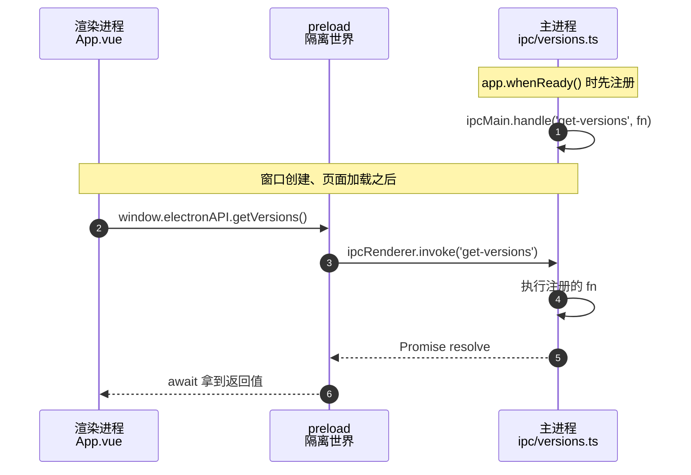

# IPC 通信

本文说明主进程与渲染进程之间的通信机制，以及本项目当前的实现方式。

配套阅读：[开发启动时序](./dev-startup.md)、[项目文件说明](./files.md)

---

## 核心概念

渲染进程与主进程是**两个独立进程**，不能直接调用对方的代码。它们之间只能通过 IPC（Inter-Process Communication，进程间通信）通信。

本项目采用 **请求-响应** 模式，由 **通道名（channel）** 字符串配对：

```
渲染进程 invoke('get-versions')  ←── 通道名必须完全一致 ──→  ipcMain.handle('get-versions')
```

`invoke` 与 `handle` 是成对使用的 API：渲染进程发起请求并拿到 Promise，主进程处理后返回结果。

---

## 为什么需要 preload 这一层

`webPreferences.contextIsolation: true` 让渲染进程运行在**隔离世界**（isolated world）中，页面无法访问 `ipcRenderer`：

```js
// DevTools 控制台
typeof ipcRenderer   // → "undefined"
```

因此必须由 preload 脚本持有 `ipcRenderer`，再通过 `contextBridge` 把**函数**暴露到页面的 `window` 上。

**不能直接暴露 `ipcRenderer`**，否则页面可以调用任意通道，隔离形同虚设。只能暴露白名单式的函数：

```ts
contextBridge.exposeInMainWorld('electronAPI', {
    getVersions: () => ipcRenderer.invoke('get-versions')
})
```

---

## 完整链路

以 `getVersions` 为例：



对应的三段代码：

```ts
// ① 渲染进程调用
const versions = await window.electronAPI.getVersions()

// ② preload 转发
getVersions: (): Promise<RuntimeVersions> => ipcRenderer.invoke('get-versions')

// ③ 主进程处理
ipcMain.handle('get-versions', (): RuntimeVersions => ({
    node: process.versions.node,
    chrome: process.versions.chrome,
    electron: process.versions.electron
}))
```

---

## 注册时机

```ts
app.whenReady().then(() => {
    registerVersionHandlers()
    registerImageHandlers()

    createWindow()
})
```

**必须先注册 handler，再创建窗口。**

若顺序颠倒，页面加载后会立即调用 `invoke`，此时 handler 尚未注册，调用直接失败：

```
Error: No handler registered for 'get-versions'
```

`ipcMain.handle` 不会等待后续注册，也不会重试。

`registerXxxHandlers()` 的作用只是把 `ipcMain.handle` 的调用集中起来，让 `index.ts` 保持简洁。真正的配对关系由**通道名字符串**决定。

---

## API 对照表

| API | 方向 | 返回值 | 适用场景 |
| --- | --- | --- | --- |
| `ipcRenderer.invoke` / `ipcMain.handle` | 渲染 → 主 | 返回 Promise | 请求-响应（本项目使用） |
| `ipcMain.on` + `event.reply` | 渲染 → 主 → 渲染 | 需手动回传 | 需要回调但不用 Promise 时 |
| `webContents.send` + `ipcRenderer.on` | 主 → 渲染 | 单向推送 | 主进程主动通知 |

> `ipcMain.on` 不能与 `invoke` 配对。注册成 `on` 时 `invoke` 会失败，因为 `on` 不处理返回值。

---

## 当前通道

| preload 函数 | 通道名 | 主进程注册位置 | 返回值 |
| --- | --- | --- | --- |
| `getVersions()` | `get-versions` | `src/main/ipc/versions.ts` | `RuntimeVersions` |
| `pickImage()` | `image:pick` | `src/main/ipc/image.ts` | `ImagePreviewResult \| null` |
| `readImage(filePath)` | `image:read` | `src/main/ipc/image.ts` | `ImagePreviewResult` |
| `getPathForFile(file)` | — （非 IPC，本地同步调用） | — | `string` |

**通道命名约定**：功能名用冒号分段，如 `image:pick`、`image:read`。统一前缀便于按模块归类。

---

## 参数传递规则

### 主进程 handler 的第一个参数永远是 event

```ts
ipcMain.handle('image:read', (_event, filePath: string) => { ... })
//                        ↑ 固定为 IpcMainInvokeEvent，业务参数从第二个开始
```

多参数传递时一一对应：

```ts
ipcRenderer.invoke('channel', a, b, c)
ipcMain.handle('channel', (_event, a, b, c) => { ... })
```

### 使用 event.sender 获取发起调用的窗口

```ts
const win = BrowserWindow.fromWebContents(event.sender)
const result = win ? await dialog.showOpenDialog(win, options) : await dialog.showOpenDialog(options)
```

把 `win` 作为父窗口传入，对话框会居中于该窗口并正确归属到任务栏。不传也能弹出，但会是独立模态窗口。

### 序列化限制

IPC 使用**结构化克隆**（structured clone），因此：

| 可传输 | 不可传输 |
| --- | --- |
| 字符串、数字、布尔、`null` | 函数 |
| 数组、普通对象 | 类实例（丢失原型） |
| `Uint8Array`、`ArrayBuffer` | `Symbol` |
| `Date`、`Map`、`Set` | DOM 节点 |

**`File` 对象无法直接传递**。拖拽场景必须先用 `webUtils.getPathForFile(file)` 转成字符串路径：

```ts
// preload
getPathForFile: (file: File): string => webUtils.getPathForFile(file)
```

> Electron 32 起 `File.path` 已被移除，必须使用 `webUtils`。它只在 preload 世界可用，因此要封装后暴露。

---

## 错误处理

主进程 handler 中抛出的异常会传递到渲染进程，但**不是原始 Error 对象**：

```ts
// 主进程
throw new Error('不支持的文件类型：.txt')

// 渲染进程捕获到的对象
// - message 中包含原始信息
// - stack 会被加上 IPC 调用栈前缀
// - name 可能被改写
```

因此判断错误类型应基于 `message` 内容，不能依赖 `instanceof`：

```ts
catch (err) {
    error.value = err instanceof Error ? err.message : String(err)
}
```

---

## 类型定义的组织

类型统一放在 `src/shared/types.ts`，主进程、preload、渲染进程共同引用：

```
src/shared/types.ts
        │
        ├── src/main/ipc/versions.ts     import type { RuntimeVersions }
        ├── src/main/lib/image.ts        import type { ImagePreviewResult }
        ├── src/preload/index.ts         import type { ... }
        └── src/renderer/components/...  import type { ... }
```

**渲染进程不直接引用 preload 的源码**，只从 `shared` 取类型，避免产生不必要的耦合。

`window.electronAPI` 的类型声明在 `src/preload/global.d.ts`：

```ts
import type { ElectronAPI } from './index'

declare global {
    interface Window {
        electronAPI: ElectronAPI
    }
}
```

`ElectronAPI` 由 `typeof api` 自动推导，新增函数时无需手动维护类型。

---

## 新增一个 IPC 的步骤

以新增 PDF 预览为例：

```
1. src/shared/types.ts           新增 PdfPreviewResult 接口
2. src/main/lib/pdf.ts           纯逻辑：校验、读取、转换（不依赖 electron）
3. src/main/ipc/pdf.ts           编写 handler，导出 registerPdfHandlers()
4. src/main/index.ts             在 whenReady 中调用 registerPdfHandlers()
5. src/preload/index.ts          向 api 对象添加 pickPdf 方法（类型自动推导）
6. 渲染进程                       通过 window.electronAPI.pickPdf() 调用
```

**分层原则**：

| 层 | 是否依赖 electron | 职责 |
| --- | --- | --- |
| `lib/*.ts` | 否 | 纯数据处理，可独立测试 |
| `ipc/*.ts` | 是 | 对话框、`ipcMain.handle` 注册 |
| `index.ts` | 是 | 仅负责启动流程与注册调用 |

---

## 安全要点

1. **只暴露函数，不暴露 `ipcRenderer`**：页面无法调用未声明的通道
2. **主进程校验所有输入**：渲染进程传来的路径不可信任，需做扩展名白名单与大小限制
3. **不要拼接用户输入到路径后再读取**：防止路径穿越（`../../`）
4. **保持 `contextIsolation: true` 与 `nodeIntegration: false`**：当前配置已符合
5. **保持沙箱开启**：`sandbox: true` 时 preload 仍可使用 `require('electron')`（仅限 electron 模块），
   但无法使用 `fs` 等 Node 内置模块，所有文件操作必须走 IPC 交给主进程