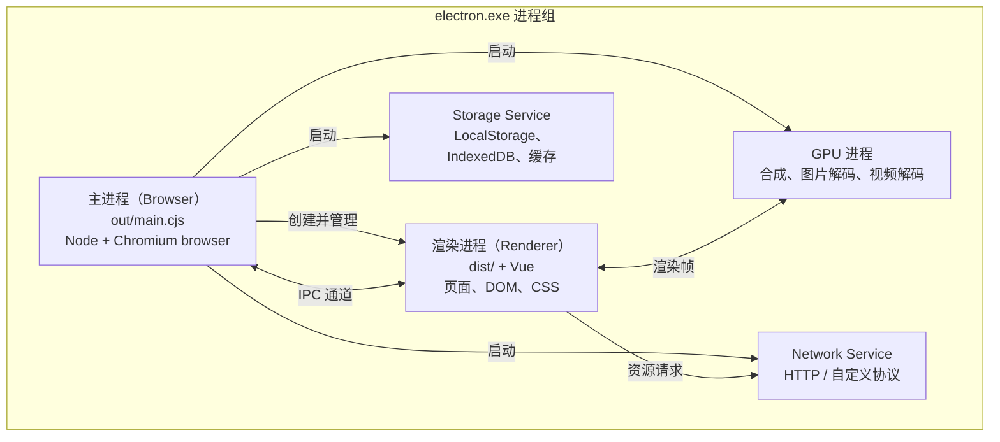
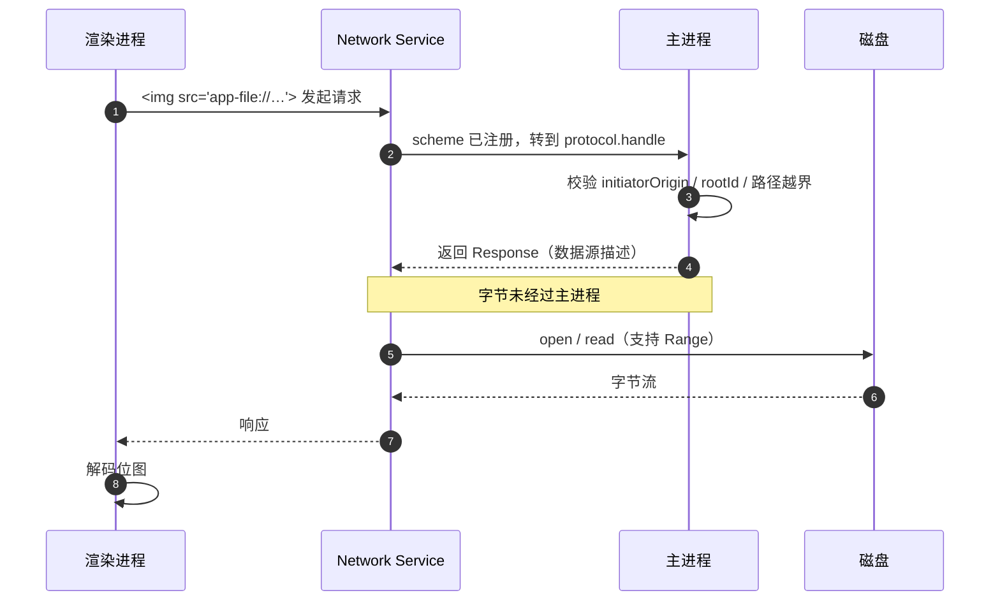

# 进程模型

本文说明本项目运行时实际存在哪些进程、各自负责什么，以及一次 `app-file` 请求如何跨越它们。

配套阅读：[app-file 协议](./app-file-protocol.md)、[IPC 通信](./ipc.md)、[开发启动时序](./dev-startup.md)

---

## 本项目的五个进程

代码里只写了两个（主进程、渲染进程），但运行时 Chromium 还会拉起自己的服务进程。用系统任务管理器
打开后，会看到 `Electron` 下有 5 个子进程：



| 进程 | 代码位置 | 职责 |
| --- | --- | --- |
| 主进程 | `src/main/` → `out/main.cjs` | 创建窗口、注册 IPC 与协议、文件 IO、生命周期 |
| 渲染进程 | `src/renderer/` → `dist/` | 运行 Vue 应用，渲染界面 |
| GPU 进程 | Chromium 自带 | 图层合成、位图解码、视频解码 |
| Network Service | Chromium 自带 | 所有网络请求，包括 `app-file:` |
| Storage Service | Chromium 自带 | 站点存储、缓存 |

预加载脚本（`out/preload.cjs`）**不是独立进程**，它运行在渲染进程内，但处在隔离的 V8 上下文中
（`contextIsolation: true`）。

## 进程与线程

日常容易把两个概念混为一谈：

| 概念 | 说明 |
| --- | --- |
| 进程 | 操作系统级的隔离单位，有独立内存空间。上表每一行都是一个进程 |
| 线程 | 进程内的执行单元。主进程与渲染进程的 **JS 执行都是单线程的** |

主进程内的真实情况：

```
主进程（一个进程）
├── JS 主线程          ← 你的 main.cjs 在这里运行，永远单线程
├── libuv 线程池       ← fs / dns / crypto 等异步 IO 在这里执行
├── V8 GC 线程
└── 平台相关线程（消息循环等）
```

所以 `await fs.readFile()` 并不会「在主进程里读文件」——JS 主线程把任务交给 libuv 线程池后就让出去了，
IO 完成后通过事件循环回到 JS 主线程。**JS 层面的单线程模型不会因为 `fs` 而改变**。

渲染进程同理，除了 JS 主线程，还有合成线程、光栅化线程等 Chromium 内部线程。

## 一次 app-file 请求跨了哪些进程

这是理解本设计性能特征的关键：



要点：

1. **主进程只参与鉴权阶段（第 3~5 步）**，返回后立即退出这条链路
2. 字节流从 Network Service 直接送到渲染进程，**不经过主进程的 JS**
3. 因此大图、长视频不会阻塞主进程，也不会撑爆主进程内存

对比图片预览最初的实现（`fs.readFile` + base64 + IPC），字节需要完整穿过主进程 JS，
既占内存又占用主线程时间。

## 渲染进程本身的子结构

渲染进程内部还有几块值得知道：

| 组成部分 | 说明 |
| --- | --- |
| JS 主线程 | 运行 Vue、你的组件代码、DOM 操作 |
| 预加载隔离世界 | 运行 `preload.cjs`，持 `ipcRenderer`，通过 `contextBridge` 暴露函数 |
| 合成线程 | 把图层合成到屏幕，不受 JS 阻塞影响 |
| Web Worker | 按需创建，用于 CPU 密集计算 |

`contextIsolation: true` 让页面 JS 与预加载处于**两个不同的 V8 上下文**，共享同一个 DOM，
但变量不互通。这正是必须用 `contextBridge` 而不是直接挂 `window` 的原因。

## 何时需要主动增加进程或线程

目前不需要。遇到下列情况再考虑：

| 场景 | 方案 | 说明 |
| --- | --- | --- |
| 语法高亮、模糊搜索等 CPU 密集任务 | `new Worker()` | 渲染进程内的独立线程 |
| 大量文件的遍历或搜索 | `worker_threads` | 主进程侧开线程，避免阻塞 IPC |
| 调用外部命令（git、编译器） | `child_process` | 独立进程 |
| 运行不可信代码（插件、用户脚本） | `utilityProcess` | Electron 专有，独立进程与 session |

VS Code 正是因为要运行第三方扩展（不可信代码），才额外有 Extension Host 进程、Shared Process、
PTY Host 进程。本项目不加载第三方插件，因此不引入这层隔离。

## 如何确认进程身份

系统任务管理器只能看到 PID 与内存，无法判断角色。两种更准确的方式：

**① Chromium 内置任务管理器**

在任意窗口按 `Shift + Esc`（或 DevTools → More tools → Task Manager），
会列出每个进程的类型（`Browser` / `Renderer` / `GPU Process` / `Utility: Network Service`）与 PID。

**② 打印主进程 PID**

```ts
app.whenReady().then(() => {
    console.log('main pid:', process.pid)
})
```

对照任务管理器中的列表即可定位主进程。

## 内存的直观参考

开发模式下的典型分布（空闲状态）：

| 进程 | 量级 | 备注 |
| --- | --- | --- |
| 主进程 | ~50 MB | 包含整个 Chromium browser 侧 + Node 运行时 |
| 渲染进程 | ~45 MB | 开发模式含 Vite HMR 客户端，生产构建后会明显下降 |
| GPU 进程 | ~20 MB | |
| Network Service | ~14 MB | |
| Storage Service | ~8 MB | |

主进程内存高于渲染进程，是 Electron 的常态。

## 相关文件

| 文件 | 职责 |
| --- | --- |
| `src/main/index.ts` | 主进程入口，创建窗口、注册 IPC 与协议 |
| `src/main/protocol.ts` | 自定义协议处理器（在主进程中执行鉴权） |
| `src/preload/index.ts` | 预加载脚本，运行于渲染进程的隔离世界 |
| `src/renderer/main.ts` | 渲染进程入口，挂载 Vue 应用 |
